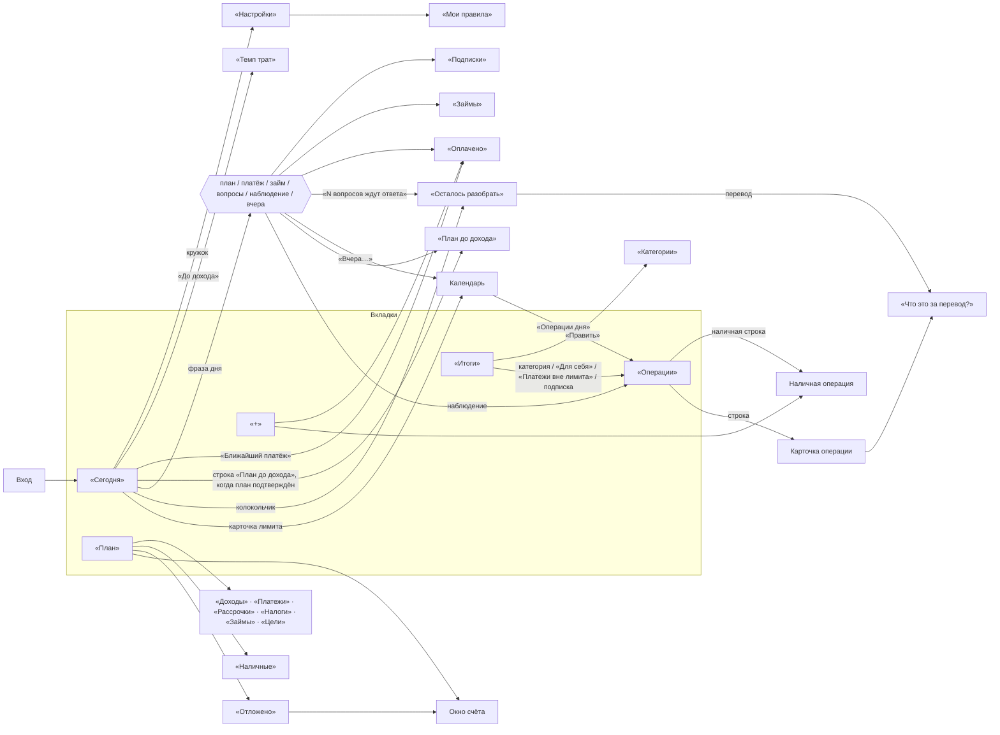

# Hale: что у нас есть и как по нему ходит человек (23 ноября 2026)

Обзор собран по коду `main` на `ac14fc8` (после этапа «Ясность»). Экраны глазами не открывались: всё, что требует взгляда, отмечено в конце. Сервер на момент обзора ещё не выложен с правками 22–23 ноября, поэтому часть возможностей у владельца пока не видна (раздел 6).

## 1. Коротко

- **Ядро работает.** Банк приходит сам, «Сегодня» отвечает «сколько можно сегодня», календарь лимита, «До дохода», вопросы о непонятных операциях, наличные, план со счетами, доходами, платежами, рассрочками, займами, налогами и целями, «Итоги» по категориям, местам и подпискам.
- **Главный путь дня короткий:** открыть «Сегодня» → увидеть лимит → (иногда) ответить на вопрос в одно касание. Он почти не рвётся.
- **Рвутся второстепенные пути:** наличные, «Оплатил платёж», правка уже записанного, первый запуск. Там встречаются тупики, молчаливые ошибки и формы, из которых нет шага назад.
- **Больше всего мешает язык.** Одна вещь называется по-разному в разных местах («запас» — шесть названий, «свои» — шесть, вопросы — пять), формы говорят «Получил», «Снял», «Погасил» вместо «вы», есть слова, которые пугают («свободных денег нет», «просрочен»).
- **Найдено несколько настоящих ошибок** (раздел 5.1): например, поправка наличных «Не записано» в своей карточке пишет «Тратит лимит дня», хотя лимит она не трогает, а «Наличными не снимал» показывается, когда человек ещё не отвечал.

## 2. Что есть в приложении

| Где | Что умеет |
|---|---|
| **Вход** | Пароль, ошибки понятными словами, выход с вопросом «Выйти из Hale?». Без связи показывается последнее «Сегодня» из памяти телефона (до 7 дней) с пометкой, за какой день. |
| **«Сегодня»** | Карточка «Сегодня можно» (полоса, «потрачено ₴X из ₴L» с шевроном → календарь), календарь лимитов с серией дней, карточка «До дохода» с графиком и ближайшим платежом, лист «Темп трат», одна фраза дня (план, просроченный платёж, займ, вопросы, завтрашний платёж, наблюдение о категории или подписках, вчерашний день), «План до дохода» в трудный период, колокольчик с вопросами, кружок профиля → «Настройки». |
| **Вопросы** («Осталось разобрать») | Пришло ли на Binance, вывод ли это с Binance, откуда наличные, оплата ли это платежа, снял ли наличными, когда следующий доход, что это за перевод. Почти все — одним касанием. |
| **«Операции»** | Траты / Доходы / Все, поиск, фильтры (период, счёт, категория), строка-сводка с суммой и «×», переходы сюда с конкретным фильтром из «Сегодня» и «Итогов». |
| **Карточка операции** | Сведения сверху («Считается в лимите дня» / «Не в лимите — …», «В обработке у банка»), категория одной плашкой с «Изменить», «Эта покупка: Нужное / Для себя», тип в «Ещё», «Всегда так для …?» с правилом, «Что это за перевод», наличные (снял ли, откуда). |
| **«+»** | «Трата» наличными, «Получил», «Оплатил платёж», «Перевёл между своими» (в свои или обмен USDC). |
| **«План»** | «Свои деньги» и «Счета», «Отложено» (с «Сейчас пусто»), окно счёта (переименовать, «Входит в свои деньги»), Binance, наличные (начать учёт, пересчитать), «До дохода», разделы «Доходы», «Платежи», «Рассрочки», «Налоги», «Займы», «Цели» («Где копите?»). Правка любой строки — касанием, «Удалить» внутри. |
| **«Итоги»** | Месяц с перелистыванием и сравнением «в октябре за те же дни», «Категории» (каждая → её операции), «Для себя», «Платежи вне лимита», «Места», «Подписки» (смахнуть → «Не подписка»), «Править» категории (свои, порядок, значок, нужное/для себя). |
| **«Настройки»** | «Сколько тратить в месяц» с предпросмотром дневного лимита, «Мои правила», когда обновлялся банк, сверка, «Выйти». |

## 3. Карта переходов

Особенности, которые видно только на карте:

- **«План до дохода» живёт только на «Сегодня»**, хотя на «Плане» есть раздел «До дохода» — другой, со списком платежей. Два «до дохода» про разное.
- **«Мои правила» — только из «Настроек»**, а правила рождаются в карточке операции («Да, всегда»). Из карточки к ним не попасть.
- **Все пути в «Операции» с фильтром идут с других вкладок.** Сами «Операции» никуда не ведут, кроме карточки.
- **Лист «Подписки» есть в двух местах**, и ведёт себя по-разному: в «Итогах» строки нажимаются и смахиваются, на «Сегодня» — нет.

## 4. Главные пути одного дня

| Путь | Как идёт | Где рвётся |
|---|---|---|
| **Утро: «сколько можно сегодня»** | Открыть → «Сегодня можно ₴X» → при желании календарь. | Если кэш со вчера — крупно «Сегодня можно» со вчерашней цифрой, дата мелко. Ровно ₴0 — полоса красная (так решено раньше, но спорит с правилом о красном — см. 5.1б). |
| **Ответить на вопрос** | Колокольчик или фраза → «Осталось разобрать» → одно касание. | Если ответ не сохранился, карточка молча возвращается — без слова, что не вышло. На «Когда следующий доход?» только 3 варианта (3 дня, неделя, 2 недели) — другой срок не указать. «Да, часть» в «Снял наличными?» — назад к трём ответам не вернуться. |
| **Записать трату наличными** | «+» → «Трата» → сумма, категория → «Сохранить». | Если кошелёк не загрузился, форма ведёт себя как у начатого, а сервер отвечает «учёт не начат» — «Не удалось сохранить» на каждой попытке. Первый раз сначала спрашивают «Сколько наличных сейчас?» (после этой траты) — раньше суммы самой траты. |
| **Отметить оплату платежа** | «+» → «Оплатил платёж» или фраза → «Оплачено». | Подзаголовок «просрочен с 6 ноя» (на «Сегодня» то же самое — «ждёт с»). Кнопка «Оплачено» и при частичной оплате, когда строкой выше «Платёж останется открытым». Полная сумма повторена до трёх раз. |
| **Поправить операцию** | «Операции» → строка → карточка. | Карточка закрывается по-разному: после «Откуда наличные» и «Да, всегда» — сама, после категории и типа — нет. Ошибка сохранения — в самом низу, можно не увидеть. «Категория» предлагает траты даже для дохода и переводов между своими. |
| **Посмотреть, куда ушли деньги** | «Итоги» → категория → «Операции». | Знак меняется: в «Итогах» «₴3,420», в сводке «Операций» «−₴3,420». «Места» не нажимаются, хотя фильтр по месту уже есть. «Платежи вне лимита» становятся нажимаемыми только после того, как «Операции» хоть раз загрузились. |
| **Настроить план** | «План» → раздел → строка или «Новый …». | Налог нельзя ни поправить, ни удалить — только «Отметить оплаченным» (без подтверждения и отмены). Платёж нельзя перевести из «каждый месяц» в «разовый» и обратно, у рассрочки — поправить число оставшихся платежей, у займа — сумму и дату. |
| **Первый запуск** | Вход → «Сегодня». | Нет отдельного «ещё не настроено»: человек без доходов видит «Сегодня можно ₴0» и «До следующего дохода свободных денег нет.» — то есть первый экран говорит о нехватке. |

## 5. Что мешает, по темам

### 5.1. Ошибки — показывает не то

1. **«Не записано» в своей карточке пишет «Тратит лимит дня».** Поправка после пересчёта наличных лимит не трогает (так и написано в «Наличных»: «Лимит дня не изменится»), а карточка говорит обратное (`CashOperationSheet.tsx`).
2. **«Наличными не снимал»** в карточке операции, когда человек ещё не отвечал: «не отвечено» и «нет» выглядят одинаково.
3. **Строка «Что это за перевод» и кредитная пометка в карточке** не меняются после смены типа внутри карточки (взяты из открытого снимка).
4. **Тип «Получил» из «+»** записывается как «От человека» — в списке это другое слово, чем в меню.
5. **Время в карточке операции — по часам телефона, дни в списке — по Киеву:** вне Украины даты могут разойтись.
6. **Переход в «Операции» из неизвестного вопроса** открывает их с прошлыми фильтрами — нужной строки там может не быть.
7. **«Изменить тип» у операции с ответом «Откуда наличные»** молча отменяет этот ответ.
8. **На будущее:** когда включим push (нужен Apple Developer), после «Выйти» уведомления продолжат приходить — отписать телефон приложению сейчас нечем.

### 5.1б. Так задумано, но читается как ошибка

- **Ровно ₴0 — полоса красная.** Это ваше прежнее решение («при перерасходе или нуле полоса полная и краснеет»), но оно спорит с правилом «красный только для перерасхода»: день, потраченный ровно в лимит, — не перерасход. Вопрос в разделе 7.
- **Сводка «Операций» на «Тратах» считает меньше, чем строк на экране:** строки «не из лимита» показаны, но в число не входят (решение Б2 от 11 ноября). Человек видит «12 операций» и 14 строк.
- **После «Не подписка» строка «₴X в месяц · N подписок» ещё показывает старые цифры**, пока сервер не пересчитает (ЯМ6 так сделан, чтобы приложение само не считало деньги).
- **«Отложено» с подписью «не входит в свои деньги» содержит свои пустые места:** пустые карты, кошелёк «не начат» и Binance «не задан» стоят под «Сейчас пусто» (ЯМ5, вариант А), а в окне счёта у них включено «Входит в свои деньги».

### 5.2. Тупики и молчаливые ошибки

- Ответ на вопрос не сохранился — карточка возвращается без слов (и введённая часть суммы пропадает).
- «Не показывать такое» под наблюдением и в «Подписках» — при ошибке ничего не сообщает.
- Вторая страница «Операций» не загрузилась — список просто кончается.
- «Настройки», «Мои правила», «Наличные», «Налоги», «Платежи», Binance: при ошибке загрузки — красная строка без «Повторить» (кнопка есть в «Займах», «Итогах», «Операциях», календаре, «Плане до дохода» и на «Сегодня»).
- «Править» в «Итогах» пропадает, если категории не загрузились, — повторить негде.
- Наличные: ошибка «учёт уже начат» повторяется, пока лист не открыть заново; если первая трата не сохранилась после начала учёта, кошелёк остаётся начат на сумму с этой тратой.
- «+» без шага назад: выбор пункта меню заменяет меню, «Закрыть» закрывает всё.
- Любой лист закрывается смахиванием без вопроса — начатая форма теряется молча.
- «Где копите?» пропадает, если нет мест в «Отложено» и Binance, — вместе с ним пропадает и «Другое место». Новое место, созданное с включённым «Входит в свои деньги», в списке не появится никогда.

### 5.3. Выглядит нажимаемым — не нажимается (и наоборот)

- Колокольчик без вопросов: такой же кружок, как кнопка, но не нажимается.
- Фраза дня — обычный текст, но кнопка, и ведёт каждый день в разное место.
- Карточка лимита без лимита: шеврона нет, а касание открывает календарь.
- В трудный период карточка просит «подтвердить план», а касание открывает календарь — план только через фразу.
- График «До дохода» можно вести пальцем — подсказки нет.
- «Места» в «Итогах» не нажимаются; подписки нажимаются только на «Итогах».
- Смахивание «Не подписка» ничем не подсказано.
- Отключённый переключатель «Из моих наличных» выглядит как обычный.

### 5.4. Одна вещь — много слов

| Вещь | Как называется сейчас |
|---|---|
| Деньги до дохода | «Запас к доходу», «К доходу останется», «останется», «Запас на 30 дней», «Деньги до нуля», «ноль» |
| Свои / между своими | «Перевёл между своими», «Перевёл в свои», «Между своими», «Свои счета», «Это мой счёт», «свои» |
| Вопросы | «Вопросы» (колокольчик), «Осталось разобрать» (лист), «…ждут ответа» (фраза), «Ждёт ответа» (строка), «Кто это: …?» |
| План в трудный период | «План до дохода», «план моста» (в тексте сервера); а «До дохода» на «Плане» — про другое |
| Остаток наличных | «По записям», «Наличных по записям», «Остаток», «Наличные сейчас», «Сколько в кармане», «Наличные после этой траты» |
| Лимит в операции | «не из лимита» (список), «Не в лимите — …» (карточка), «Считается в дневном лимите» (ответы о переводе) |
| Сверка | «Сверка: больше, чем записано» (наличные) и «Сверка: всё сходится» (настройки) |
| Синхронизация | «Банк обновлялся», «Синхронизации с банком ещё не было» |
| Отказ в удалении | «Оставить» и «Отмена» в разных листах |
| «Другое» | В вопросе о переводе — «показать ещё», в вопросе о наличных — окончательный ответ |
| Платежи | «Платежи» на «Плане» (только обязательные) и «Платежи вне лимита» в «Итогах» (ещё налоги, рассрочки, долги) |
| Профиль / настройки | Значок человека с подписью «Настройки» |

Обращение. Приложение говорит «вы», а формы — мужским родом от первого лица: «Получил», «Оплатил платёж», «Перевёл», «Обменял», «Отдал USDC», «Погасил», «Пересчитал», «Снял наличными?», «Сколько снял».

### 5.5. Одно число — несколько раз

- Лимит на «Сегодня» — до трёх раз: «из ₴L», «если держаться лимита ₴L в день», «План до дохода ₴L в день».
- Ближайший платёж — фразой «Сегодня платёж: …» или «Завтра платёж: …» и строкой «Ближайший платёж» с той же суммой.
- Число вопросов — значком на колокольчике и фразой.
- Всплеск категории — фразой на «Сегодня», карточкой-наблюдением в «Операциях» и в сводке фильтра.
- Подписки — фраза говорит сумму за неделю, лист — за месяц.
- Серия дней — в подзаголовке календаря и во фразе «Уже N дней в лимите».
- «Не хватает до дохода ₴X» и «Не хватает ₴X. План можно подтвердить…» в одном листе.
- Сумма платежа в «Оплачено» — до трёх раз.

### 5.6. Тон

- Пугает: «До следующего дохода свободных денег нет.», «В таком темпе денег хватит только на сегодня.», «Свободных денег уже нет.», «деньги закончатся», «кредитный лимит потрачен весь», строки сверки «не сходится ₴X».
- Может стыдить: «просрочен с …», «Вчера вышло на ₴X больше лимита.», «Не записано».
- Красный — в «Удалить» карточки наличной операции и формы категории (по правилу — только перерасход и ошибки; остальные «Удалить» уже серые).

## 6. Что видно только после деплоя

Сервер сейчас — `8da8119` (22 ноября). Пока он не выложен, у владельца нет: нажимаемых «Платежей вне лимита» и подписок в «Итогах» (фильтры `other` и `place`), смахивания «Не подписка», целей с местом, дат «9 ноя» в вопросах и «на карту ··4563», подписи «Перевёл в свои» у новых наличных переводов, Б55 (однократная перепроверка категорий старых операций), Б56, А24а и А24а2. Миграции: 0040, 0041.

## 7. Что дальше — предложение

Новых экранов не нужно: почти всё в разделе 5 — поправки внутри того, что есть. Предлагаю этап «Ясность-2: путь дня без шероховатостей» из четырёх пакетов, по порядку:

1. **Ошибки (5.1, пункты 1–7)** — без макета, по одной задаче на пункт. Пункт 8 (push после выхода) — вместе с этапом Г, когда будет Apple Developer.
2. **Тупики и молчаливые ошибки (5.2)** — общий приём для всех листов: «Повторить» при ошибке загрузки, короткая строка при неудачном ответе, шаг назад в «+», вопрос перед закрытием начатой формы. Без макета.
3. **Словарь (5.4) и «вы»** — сначала одна страница: одна вещь — одно слово, на согласование вам; потом правки текстов по ней. Тексты сервера — отдельным PR.
4. **Первый запуск** — спокойное «ещё не настроено» вместо «свободных денег нет» и путь «добавьте доход → появится лимит». С макетом.

### Вопросы к вам

Первый нужен, чтобы начать; остальные — небольшие задачи, которые по вашему ответу войдут в пакет 1 (кроме 6 и 7: они идут сами по себе, когда до них дойдёт очередь).

1. **Записать этап «Ясность-2» из четырёх пакетов в очередь?**
   - **А (рекомендую):** да, в этом порядке — сначала ошибки, затем тупики, словарь, первый запуск;
   - **Б:** да, но первым — первый запуск (он нужнее к приходу друзей);
   - **В:** пока нет.
2. **Ровно ₴0 на «Сегодня»** (меняет ваше прежнее решение «при перерасходе или нуле полоса краснеет»):
   - **А (рекомендую):** полоса полная, но песочная; красная — только когда лимит превышен. Так требует правило о красном, и так уже считает календарь: день, потраченный ровно в лимит, там «в лимите»;
   - **Б:** оставить красной, как решили раньше.
3. **Строка «если держаться лимита ₴L в день» в «До дохода»** (это часть ЯМ1, сделанного по вашему макету): она — условие, при котором верно «К доходу останется ₴X», а в день перехода на новый лимит называет уже завтрашний лимит, не тот, что на карточке.
   - **А (рекомендую):** оставить как есть;
   - **Б:** убрать — тогда «К доходу останется ₴X» будет звучать как обещание, и условие придётся сказать иначе.
4. **Фраза «Сегодня платёж…» / «Завтра платёж…»**, когда тот же платёж уже стоит строкой «Ближайший платёж» в «До дохода»:
   - **А (рекомендую):** в такой день фразу не показывать — вместо неё фраза дня следующая по очереди;
   - **Б:** оставить обе.
5. **Свои пустые места в «Отложено»** (так решено в ЯМ5 23 ноября — «Все А»):
   - **А (рекомендую):** оставить как решили — пустые места под «Сейчас пусто» с подписью внизу;
   - **Б:** вернуть их в «Счета» тихой строкой «₴0», а в «Отложено» оставить только отложенное — подпись «не входит в свои деньги» станет буквально правдой;
   - **В:** оставить в «Отложено», но сменить подпись окна на «отложено и пустые счета».
6. **Платёж «каждый месяц» ↔ «разовый»:**
   - **А (рекомендую):** разрешить в правке (сейчас — только удалить и создать заново);
   - **Б:** оставить как есть.
7. **«Места» в «Итогах»:**
   - **А (рекомендую):** сделать нажимаемыми, как подписки — открывают операции этого места; работает с сервером, где есть фильтр по месту (после деплоя);
   - **Б:** оставить без нажатия.

## 8. Что посмотреть глазами

- Новая сборка на телефоне (см. сводку дня 23 ноября): «Сегодня» с двумя кружками и шевроном, карточка операции, правка касанием на «Плане», «Сейчас пусто», «Займы», «Для себя».
- После деплоя: смахивание «Не подписка» и прокрутка рядом, новая цель с местом, что прошлые Bolt Food и Uber Eats перешли в «Кафе».
- Для этого обзора: первый запуск на пустой базе (что видно вместо «свободных денег нет»), день, потраченный ровно в ₴0, пересчёт наличных с недостачей и карточка «Не записано».
